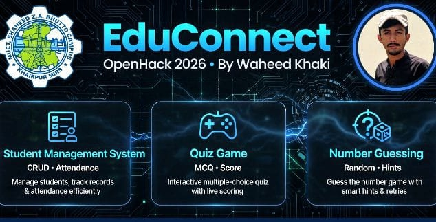

# 🚀 EduConnect - OpenHack 2026
### Mehran University Khairpur | Khairpur, Sindh, PK

> An educational platform with games to make learning fun!

### 📚 Features
- **Student Management System** (`main.cpp`) - Add students, calculate grades
- **Number Guessing Game** (`game.cpp`) - Fun logic game 1-100
- **Quiz Game** (`quiz.cpp`) - Educational quiz with scoring

### 🛠️ Tech Stack
- Language: C++
- Platform: Console Based
- Made for: OpenHack 2026

### ▶️ How to Run
```bash
g++ main.cpp -o main
./main

g++ game.cpp -o game
./game

g++ quiz.cpp -o quiz
./quiz

